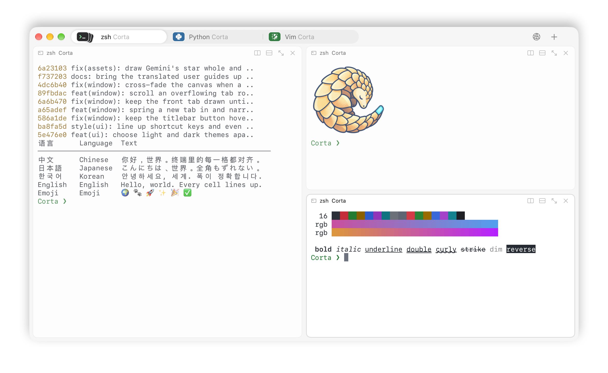

<div align="center">


# Corta

**A fast, focused terminal. Made for Mac. Built in Swift.**

Metal 4 rendering · Native CJK / IME · SSH, SFTP and remote editing

> For people who live in the terminal: crisp text, native input, powerful remote workflows, and a Swift terminal core with **zero** third-party dependencies. Fast enough for demanding output. Thoughtful enough for everyday work.

[](https://github.com/noah-qin/Corta/actions/workflows/ci.yml)
[](https://github.com/noah-qin/Corta/releases/latest)


[](LICENSE)
[](https://discord.gg/QNdWfdwr7j)
[](https://github.com/sponsors/noah-qin)

**[↓ Download](https://github.com/noah-qin/Corta/releases/latest)** ·
**[Website](https://corta.noahqin.dev)** ·
**[User guide](docs/USER-GUIDE.md)** ·
[Documentation](docs/README.md) ·
[Contribute](CONTRIBUTING.md) ·
[Discord](https://discord.gg/QNdWfdwr7j) ·
[Report a bug](https://github.com/noah-qin/Corta/issues/new?template=bug_report.yml)

🇺🇸 [English](README.md) · 🇨🇳 [简体中文](docs/i18n/zh-CN/README.md) · 🇭🇰 [繁體中文](docs/i18n/zh-Hant/README.md) · 🇯🇵 [日本語](docs/i18n/ja/README.md) · 🇰🇷 [한국어](docs/i18n/ko/README.md) · 🇩🇪 [Deutsch](docs/i18n/de/README.md) · 🇫🇷 [Français](docs/i18n/fr/README.md) · 🇪🇸 [Español](docs/i18n/es/README.md) · 🇧🇷 [Português](docs/i18n/pt-BR/README.md)

<a href="https://corta.noahqin.dev/en/#demo">
  
</a>

</div>

## Install

Requires **macOS 26.0 or later**, **Apple silicon** (M1 or later), and a
**Metal 4-capable GPU**. Virtual machines with a paravirtual GPU are not
supported. Intel Macs can use the older
[1.0.1 release](https://github.com/noah-qin/Corta/releases/tag/v1.0.1).

Download the `.dmg` and matching `.dmg.sha256` file from
[GitHub Releases](https://github.com/noah-qin/Corta/releases/latest).
Keep both files in the same folder and verify the checksum there:

```sh
# Replace x.y.z with the version you downloaded.
shasum -a 256 -c Corta-x.y.z.dmg.sha256
```

Open the disk image, drag **Corta** into **Applications**, then eject the
image. Releases are Developer ID-signed and notarised. For later updates,
use **Corta ▸ Check for Updates…** or download a newer release.
Installation help and uninstall instructions are in
[Troubleshooting](docs/TROUBLESHOOTING.md).

## First steps

| To… | Use |
| :--- | :--- |
| Split right / down | ⌘D / ⇧⌘D |
| Search terminal output | ⌘F |
| Open the command palette | ⇧⌘P |
| Open Settings | ⌘, |

Standard local zsh sessions load the bundled shell-integration hooks
automatically with Directory suggestions enabled (the default). For
startup-file installation in zsh, bash or fish, use
**Settings ▸ Terminal ▸ Shell Integration**; this edits your shell's startup
files only when you choose Install. If an installed integration is outdated,
choose Update and open a new shell. See the
[shell-integration guide](docs/USER-GUIDE.md#shell-integration) for details.

## Why Corta

| | |
| :--- | :--- |
| **Native Mac input** | CJK input and IME composition, Core Text font fallback, VoiceOver, Secure Keyboard Entry, Services, folders opened from Finder and the Dock — through AppKit, not around it. |
| **Fast, with evidence** | Keypress latency level with Ghostty's, less memory and idle energy than Ghostty or iTerm2, and 4.4 MB instead of 185 MB for 100,000 lines of history. Every figure is published with its method and its gaps (below). |
| **Remote work built in** | System OpenSSH with your `~/.ssh/config`, a Finder-like SFTP browser with drag and drop, and remote files opened in your local editor with a conflict check before upload. |
| **One settings file** | The native Settings window and `~/.config/corta/config` edit the same store; automated checks keep the documented keys and shortcuts aligned with the code. |
| **Small core, serious safeguards** | A Swift terminal core with no third-party dependencies, resource limits for untrusted output, and a sandboxed image decoder; the app adds only [Sparkle](https://sparkle-project.org) for updates. Clipboard reads and title queries are deliberately absent ([security model](docs/SECURITY.md)). |

Split panes, scrollback search, true colour, OSC 8 links, the Kitty keyboard
and graphics protocols, shell integration and restored layouts are all
there; the [feature reference](docs/FEATURES.md) lists everything, with
requirements and limitations, and describes `main` — a published release
may not have every item yet. How Corta compares with iTerm2 and Ghostty,
and when to pick one of them instead, is in
[Features → How Corta compares](docs/FEATURES.md#how-corta-compares).
Coding-agent task state was developed against **Claude Code**, and Codex
0.166.0 was checked to report its own state through the same general parser;
other tools have generic protocol support and process detection, not dedicated
state adapters ([scope and limits](docs/CONFORMANCE.md#cli-signal-compatibility)).
Developed and acceptance-tested with Claude Code 2.1.310: interactive OSC 7501 state, with
explicit channel selection for Claude message text. tmux, Claude background
sessions and disabled terminal-title reporting have separate restrictions;
full live lifecycle acceptance is not implied by parser coverage.
Corta's macOS-only scope and its exclusion of tmux control mode, built-in
AI and a scripting engine are [settled decisions](docs/DECISIONS.md);
ordinary tmux sessions run inside Corta as terminal programs.

## Make it yours

Settings are stored in `~/.config/corta/config`. The native Settings window
and the text file edit the same configuration.

```ini
theme = midnight
theme.midnight.inherit = solarized
theme.midnight.dark.background = #101018

bind.equalize-panes = ctrl+cmd+e
bind.command-palette = cmd+shift+p
```

**View ▸ Theme editor…** opens
color pickers and separate light/dark previews. **Settings ▸ Appearance ▸
Cursor** selects block, bar or underline and an independent blink switch; the
default is a nonblinking block. System Monospaced is the only supported
primary font, with adjustable size and system fallback for missing characters.
**Settings ▸ Appearance ▸ Bottom status bar** enables selectable local metrics
(default off); click it for host details, or use **View ▸ Local host details…**.
See the [personalization tutorial](docs/USER-GUIDE.md#personalizing-the-terminal)
for the steps, network-interface selection and thermal-state limitations.

The [configuration reference](docs/CONFIGURATION.md) lists every key, default
and when changes take effect. The [user guide](docs/USER-GUIDE.md) walks
through every feature and where to find it.

## Build from source

```sh
git clone https://github.com/noah-qin/Corta.git && cd Corta
swift test --package-path CortaTerminal                     # the terminal core, no app
xcodebuild -project Corta.xcodeproj -scheme 'Corta (Dev)' build  # a development app beside your installed Corta
```

The [contributor guide](CONTRIBUTING.md) has the requirements (macOS 26,
Apple silicon, the Xcode in [`.xcode-version`](.xcode-version)), local
signing and a map of the repository; the [testing guide](docs/TESTING.md)
says which check each change needs.

## Quality, with evidence

Corta is under active development and has known issues. These measurements
are snapshots, not guarantees for every machine or workload. Each row says
which release it was measured on.

| Check | Recorded result | Measured on | Evidence |
| :--- | :--- | :--- | :--- |
| Keypress to glass, in a window, Typometer, 60 Hz | **21.0 ms** p50, 48.6 ms p99; Ghostty 1.4.0 20.9 / 45.5, iTerm2 3.7.8 22.2 / 55.6 | **1.7.0** vs Ghostty and iTerm2 | [Performance §5.5](docs/PERFORMANCE.md#55-cross-terminal-comparison) |
| Memory with 100,000 lines of history, whole app | **98 MB**; Ghostty 133 MB, iTerm2 265 MB | **1.7.0** vs Ghostty and iTerm2 | same |
| Idle, one window, 60 seconds | **0.0%** CPU, 19 wakeups; Ghostty 0.3% / 384, iTerm2 0.9% / 365 | **1.7.0** vs Ghostty and iTerm2 | same |
| Output throughput in a window, 100 MiB `cat` | **114 MiB/s**. Ghostty 175, iTerm2 11.7 | **1.7.0** vs Ghostty and iTerm2 | [§5.5](docs/PERFORMANCE.md#55-cross-terminal-comparison) |
| Scrollback memory, 100k × 120 lines, core | **4.4 MB**, down from 185 in 1.1 | **1.7.0** (`corta-bench`, one run) | [Performance §5.6](docs/PERFORMANCE.md#56-numbers-by-release) |
| Longest a hostile stream holds a pane's lock, 120 × 400, one 16 KiB slice | **0.16 ms**, down from 1,761 (`ESC # 8`); coloured erase **≤ 7 ms**, down from 57 | 1.7 vs 1.6.5 | [Performance §5.30](docs/PERFORMANCE.md#530-where-the-session-lock-a-title-change-and-the-image-caps-stand-2026-11-18) |
| Malformed UTF-8 throughput (`0xFF` / `0x80`) | **245 / 473 MiB/s**, up from 26 / 33 | 1.7 vs 1.6.5 | same |

Measured on an Apple M5 MacBook Air, macOS 27.2: the 1.7 vs 1.6.5 rows on
2026-11-19 and the 1.7.0 rows on 2026-11-20 (on AC), each comparison on the
same machine and day. The 1.7 vs 1.6.5 rows are a misbehaving or hostile
program's worst case; the 1.7.0 rows put the released app beside Ghostty
and iTerm2, run alternately. The dated sections of [Performance](docs/PERFORMANCE.md) hold the
conditions, every run and what a figure does not establish.

Known limitations include keypress-to-glass latency still above the
one-frame target, output throughput behind Ghostty's, incomplete VT
conformance, bundled shell integration for zsh, bash and fish only, and
direct-transmission-only Kitty graphics. The
[limitations reference](docs/FEATURES.md#known-limits) has the details.

## Find your way around

| I want to… | Start here |
| :--- | :--- |
| Learn every feature and where it lives | [User guide](docs/USER-GUIDE.md) |
| Configure Corta | [Configuration](docs/CONFIGURATION.md) |
| Understand a feature or limitation | [Features](docs/FEATURES.md) |
| Diagnose a problem | [Troubleshooting](docs/TROUBLESHOOTING.md) |
| Move over from iTerm2, Ghostty or Terminal.app | [Coming from another terminal](docs/USER-GUIDE.md#coming-from-another-terminal) |
| See what is planned, or suggest something | [Open issues](https://github.com/noah-qin/Corta/issues) · [Discussions → Ideas](https://github.com/noah-qin/Corta/discussions/categories/ideas) |
| Find something to work on | [Good first issues](https://github.com/noah-qin/Corta/labels/good%20first%20issue) · [Help wanted](https://github.com/noah-qin/Corta/labels/help%20wanted) |
| Make a first contribution | [Contributing](CONTRIBUTING.md) |
| Run or add tests | [Testing](docs/TESTING.md) |
| Understand the code | [Architecture](docs/DESIGN.md) · [Core API](CortaTerminal/Sources/CortaTerminal/CortaTerminal.docc/CortaTerminal.md) |
| Read the full documentation | [Documentation index](docs/README.md) |

## Contribute

Bug reproductions, documentation, translations, accessibility testing and
code contributions are welcome. Start from a
[good first issue](https://github.com/noah-qin/Corta/labels/good%20first%20issue)
or a [help wanted](https://github.com/noah-qin/Corta/labels/help%20wanted)
one, and read [CONTRIBUTING.md](CONTRIBUTING.md) for setup and review
expectations. Community participation follows the
[Code of Conduct](CODE_OF_CONDUCT.md).

Tried Corta and went back to your old terminal? That is worth hearing too:
the [Went back form](https://github.com/noah-qin/Corta/issues/new?template=went_back.yml)
needs no reproduction, and "it just felt off" is an acceptable answer.

Report vulnerabilities through the [private security channel](SECURITY.md).
To chat with other users and the maintainer, join the [Discord](https://discord.gg/QNdWfdwr7j).
For usage questions whose answers others should be able to find, go to [Discussions → Q&A](https://github.com/noah-qin/Corta/discussions/categories/q-a);
to share a theme or a setup, [Show and tell](https://github.com/noah-qin/Corta/discussions/categories/show-and-tell).
For other problems, [open an issue](https://github.com/noah-qin/Corta/issues/new/choose).

### Sponsor

Corta is built and maintained by one person, in the open. If it has become
part of your day, a sponsorship keeps it moving — every amount helps.

<a href="https://github.com/sponsors/noah-qin"></a>

### Contributors

Thank you to everyone who has contributed to Corta.

<a href="https://github.com/noah-qin"></a>
<a href="https://github.com/FrankChen-CLC"></a>

## License and identity

Source code is licensed under [Apache 2.0](LICENSE). The Corta name,
pangolin mascot and app icon have separate terms in [NOTICE](NOTICE).
The pangolin's curled body forms a C; its cyan tail is a terminal cursor.
[Brand assets](docs/brand/README.md) include the mascot and social preview.
