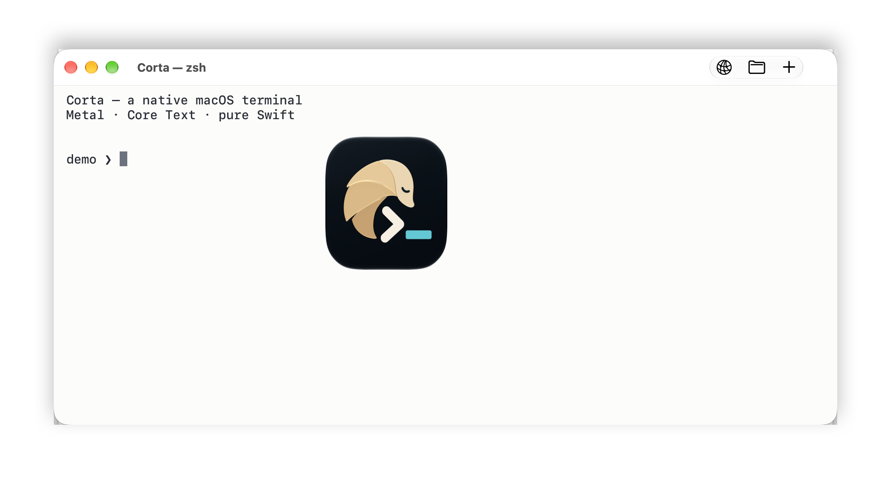

<div align="center">


# Corta

**A native macOS terminal, built in Swift.**

Metal rendering · AppKit input · A dependency-free terminal core

> Built for people who live in the terminal on Mac — real CJK / IME, Metal-smooth text, and a VT engine with **zero** third-party dependencies.

[](https://github.com/noah-qin/Corta/actions/workflows/ci.yml)
[](https://github.com/noah-qin/Corta/releases/latest)


[](LICENSE)

**[↓ Download](https://github.com/noah-qin/Corta/releases/latest)** ·
**[User guide](docs/USER-GUIDE.md)** ·
[Documentation](docs/README.md) ·
[Contribute](CONTRIBUTING.md) ·
[Report a bug](https://github.com/noah-qin/Corta/issues/new?template=bug_report.yml)



</div>

## 1.2: built for speed

Corta 1.2 is a performance release, from the byte the shell writes to the
pixel on the panel. Measured on one Apple M5 MacBook Air, before and after,
same toolchain:

- **2.3× the throughput.** The parser and grid take **356 MiB/s**, up
  from 158; output arriving from a shell, end to end, **317 MiB/s**, up from
  137. `yes` runs 70% faster, and CJK text 23% faster.
- **A frame less while you type.** A full-screen pane is presented straight
  to the display instead of through the window server: keypress to glass
  drops from 64–68 ms to **49–51 ms** at the median, and the worst cases are
  **halved**.
- **ProMotion when your fingers are on the keys.** Typing, paste and input
  methods ask for the panel's maximum frame rate — 120 Hz on ProMotion —
  then let it settle.
- **Scrolling that costs almost nothing.** A scroll region (vim, less,
  tmux, a status line) shifts what is already drawn: **5×** less CPU a frame,
  and output arriving while you read history back **10×** less.
- **Scrollback in a fraction of the memory.** Cold history is compressed as
  you go: 100,000 lines of 120 columns now take about **11 MiB, not 185**.
  Glyph atlases grow on demand: four panes at a prompt went from 81 MiB to
  about 1 MiB.
- **Quiet when it should be.** An idle blinking cursor is animated by the
  system instead of redrawn, an idle shell no longer wakes Corta four times
  a second, and a pane you cannot see drops to background priority after
  two seconds — and back the moment you type.
- **Images straight to the GPU.** Inline images are decoded in a sandbox
  into memory the GPU reads directly, with no copy through the app, and
  move with the text in vim, less and tmux.

Every figure is in [Performance](docs/PERFORMANCE.md), with its method and
what it does not show. The [changelog](CHANGELOG.md) has the full list.

## Made for macOS

Corta brings together a hand-written VT engine, Metal rendering, Core Text
shaping and native AppKit input. The terminal core is a separate Swift package
with no third-party dependencies. The app uses [Sparkle](https://sparkle-project.org)
for updates.

| Native interaction | Terminal fundamentals | Everyday workflow |
| :--- | :--- | :--- |
| CJK input and IME composition | True colour and Unicode text | Split panes and restored layouts |
| Core Text font fallback | Reflow and scrollback search | Command palette and custom shortcuts |
| Quick Terminal and Shortcuts | Bracketed paste and OSC 8 links | Shell integration and command history |
| Secure Keyboard Entry | Kitty keyboard and direct graphics protocols | OpenSSH, SFTP and remote editing |
| A System Settings–style Settings window | Kitty images in the scrollback | A Finder-like SFTP browser with drag and drop |

The table describes `main`; a release may trail it by a row or two. The
[feature reference](docs/FEATURES.md) has the details, requirements and
limitations, and the [design decisions](docs/DECISIONS.md) explain what
Corta deliberately leaves out.

## How is Corta different?

iTerm2 and Ghostty are both excellent terminals, and Corta borrows the
standards they helped set. It makes a different set of bets.

| | Corta | iTerm2 | Ghostty |
| :--- | :--- | :--- | :--- |
| Written in | Swift, end to end | Objective-C and Swift | Zig core, Swift and GTK front ends |
| Platforms | macOS only, by decision | macOS | macOS and Linux |
| Terminal core | A separate Swift package with **zero** third-party dependencies | In the app | `libghostty`, shared across platforms |
| Rendering | Metal, with Core Text shaping and font fallback | Metal | Metal on macOS, OpenGL on Linux |
| Settings | One text file, edited by a native Settings window too | Preferences UI and profiles | One text file |
| Scope | Terminal correctness; no multiplexer, no AI, no scripting engine | Everything, including tmux integration and a Python API | Terminal plus a cross-platform library |

**Why pick Corta.**

- **It is a Mac app first, not a port.** CJK input and IME composition,
  Secure Keyboard Entry, VoiceOver, Shortcuts, the Quick Terminal and the
  Services menu are built on the native AppKit paths, so they behave the
  way the rest of your Mac does — not the way a cross-platform toolkit
  approximates it.
- **Every byte from the PTY is treated as hostile.** The VT engine is
  hand-written in Swift with resource caps on every unbounded input, and
  the capabilities that let a program read your clipboard or window title
  back are deliberately absent. The [security model](docs/SECURITY.md)
  spells out the three trust boundaries.
- **One config file is the whole settings store.** `~/.config/corta/config`
  is what the Settings window edits, what a preset loads and what
  [the reference](docs/CONFIGURATION.md) documents key by key; a test fails
  when the documentation drifts from the code.
- **Remote work stays in the terminal.** SSH sessions use the system
  OpenSSH and carry their host and directory context. The toolbar's connect
  sheet suggests your recent hosts and the `Host` names in `~/.ssh/config`;
  the SFTP browser works the way Finder does — Back and Forward, a
  breadcrumb path, sortable columns, drag and drop both ways, transfers with
  speed and time left — and a remote file opens in your local editor as a
  managed copy that uploads only when you say so, with a conflict check
  against the remote first.
- **The numbers are published, including the bad ones.** Frame CPU, idle
  CPU, throughput, keypress-to-glass latency and the esctest2 result are
  measured, dated and recorded [below](#quality-with-evidence), with the
  method for each — including where a figure is still short of its target,
  as windowed keypress-to-glass latency is.

If you need tmux control mode, a Linux build or a scripting API, iTerm2 or
Ghostty is the better choice today; those are
[settled decisions](docs/DECISIONS.md), not gaps waiting to be filled.

## Install

Requires **macOS 26.0 or later** on a Mac with **Apple silicon** (M1 or
later) from 1.1.0 on. Intel Macs are not supported after
[1.0.1](https://github.com/noah-qin/Corta/releases/tag/v1.0.1), which stays
available for them. Releases after 1.1.8 use disk images. Download
`Corta-1.2.0.dmg` and `Corta-1.2.0.dmg.sha256` from
[GitHub Releases](https://github.com/noah-qin/Corta/releases/latest).
Version 1.1.8 and earlier retain their original ZIP downloads.

```sh
# Replace <version> with the chosen DMG release; keep both files together.
shasum -a 256 -c Corta-1.2.0.dmg.sha256
```

Open the disk image, drag **Corta** into **Applications**, then eject the
image. For later updates, use **Corta ▸ Check for Updates…**.

> [!NOTE]
> **Release status:** [1.2.0](https://github.com/noah-qin/Corta/releases/tag/v1.2.0),
> prepared on 2026-10-13. Manually running Release on `main` starts tests,
> build, sign and notarise the app, publish a release, and update
> the signed update feed. See [GitHub Releases](https://github.com/noah-qin/Corta/releases/latest)
> for the latest successfully published build.

For updates, use **Corta ▸ Check for Updates…** or download a newer release.
If Settings reports that the shell integration is outdated, choose Update
and open a new shell.
Installation help and uninstall instructions are in
[Troubleshooting](docs/TROUBLESHOOTING.md).

## Make it yours

Settings are stored in `~/.config/corta/config`. The native Settings window
and the text file edit the same configuration.

```ini
theme = midnight
theme.midnight.inherit = solarized
theme.midnight.dark.background = #101018

bind.equalize-panes = ctrl+cmd+e
bind.command-palette = cmd+shift+p
```

Since 1.1.5, **View ▸ Theme editor…** opens
color pickers and separate light/dark previews. **Settings ▸ Appearance ▸
Cursor** selects block, bar or underline and an independent blink switch; the
default is a nonblinking block. The primary font is System Monospaced.
**Settings ▸ Terminal ▸ Bottom status bar** enables selectable local metrics
(default off); click it for host details, or use **View ▸ Local host details…**.
See the [personalization tutorial](docs/USER-GUIDE.md#personalizing-the-terminal)
for the steps, network-interface selection and thermal-state limitations.

The [configuration reference](docs/CONFIGURATION.md) lists every key, default
and when changes take effect. Shell integration for zsh, bash and fish can be
installed from **Settings ▸ Terminal**. The [user guide](docs/USER-GUIDE.md)
walks through every feature and where to find it.

## Build and test

Use macOS 26.0 or later on Apple silicon and Xcode with Swift 6.2 or later. CI's exact Xcode
pin is recorded in [the workflow](.github/workflows/ci.yml). The app resolves
Sparkle on its first build; the terminal core has no external packages.

```sh
git clone https://github.com/noah-qin/Corta.git
cd Corta

# Build and test the terminal core without launching the app.
swift test --package-path CortaTerminal

# Build the macOS app.
xcodebuild -project Corta.xcodeproj -scheme Corta build

# Or build the development app — a separate application, with its own
# configuration and state, that runs beside an installed Corta.
xcodebuild -project Corta.xcodeproj -scheme 'Corta (Dev)' build
```

Start with the [contributor guide](CONTRIBUTING.md) for local signing and
repository orientation, and the [testing guide](docs/TESTING.md) for app
tests, golden fixtures, fuzzing and manual verification.

## Quality, with evidence

Corta is under active development and has known issues. These measurements
are snapshots, not guarantees for every machine or workload.

| Check | Recorded result | Evidence |
| :--- | :--- | :--- |
| Core feed throughput | **317.3 MiB/s** (137.2 before 1.2) | [Performance §5.14](docs/PERFORMANCE.md#514-scrolling-without-per-line-screen-allocation-281-283) |
| Parser + grid throughput | **355.9 MiB/s** (158.0 before 1.2) | same |
| Scrollback memory, 100k × 120 lines | **11.4 MiB** (185 MiB before 1.2) | [Performance §5.6](docs/PERFORMANCE.md#56-numbers-by-release) |
| Region scroll, CPU a frame, p50 | **0.026 ms** (0.130 ms before 1.2) | [Performance §5.14](docs/PERFORMANCE.md#514-scrolling-without-per-line-screen-allocation-281-283) |
| Frame CPU, 120 × 40 full rebuild, Release | **0.37–0.39 ms** | [Performance §5.17](docs/PERFORMANCE.md#517-full-screen-without-the-compositor-285-2026-10-13) |
| Keypress to glass, full screen, a person typing | **49.1–50.8 ms** p50, 82.9–84.2 ms p99 | [Performance §5.17](docs/PERFORMANCE.md#517-full-screen-without-the-compositor-285-2026-10-13) |
| Idle CPU, Release, 20 seconds | 0.05% | [Performance](docs/PERFORMANCE.md) |
| esctest2 | 131 passed, 334 known bugs, 102 failed; 567 total | [Raw results](https://github.com/noah-qin/Corta/blob/f632d5918653cc2feee28fe1baa0c0fd01e93c0e/docs/esctest/2026-10-07-results.txt) |

Measured on an Apple M5 MacBook Air (macOS 27.0.1) between 2026-10-09 and
2026-10-13, each before/after pair on the same machine and toolchain; the
dated sections of [Performance](docs/PERFORMANCE.md) hold the conditions, every run and
what a figure does not establish. Idle CPU is the 1.0.0 run's (2026-09-18),
and esctest2 1.1.5's; its 82.0% figure counts passes **plus known bugs** and
is not a pass rate. See [conformance](docs/CONFORMANCE.md) for interpretation.

Known limitations include keypress-to-glass latency above the one-frame
target in a window (full screen with one pane comes closest), incomplete VT
conformance, bundled shell integration for zsh, bash and fish only, and
direct-transmission-only Kitty graphics. The
[limitations reference](docs/FEATURES.md#known-limits) has the details.

## Find your way around

| I want to… | Start here |
| :--- | :--- |
| Learn every feature and where it lives | [User guide](docs/USER-GUIDE.md) |
| Configure Corta | [Configuration](docs/CONFIGURATION.md) |
| Understand a feature or limitation | [Features](docs/FEATURES.md) |
| Diagnose a problem | [Troubleshooting](docs/TROUBLESHOOTING.md) |
| See what is planned, or suggest something | [Milestones](https://github.com/noah-qin/Corta/milestones) · [Discussions → Ideas](https://github.com/noah-qin/Corta/discussions/categories/ideas) |
| Make a first contribution | [Contributing](CONTRIBUTING.md) |
| Run or add tests | [Testing](docs/TESTING.md) |
| Understand the code | [Architecture](docs/DESIGN.md) · [Core API](CortaTerminal/Sources/CortaTerminal/CortaTerminal.docc/CortaTerminal.md) |
| Read the full documentation | [Documentation index](docs/README.md) |

## Contribute

Bug reproductions, documentation, translations, accessibility testing and
code contributions are welcome. Pick a focused change and read
[CONTRIBUTING.md](CONTRIBUTING.md) for setup and review expectations.
Community participation follows the [Code of Conduct](CODE_OF_CONDUCT.md).

Report vulnerabilities through the [private security channel](SECURITY.md).
For usage questions, go to [Discussions → Q&A](https://github.com/noah-qin/Corta/discussions/categories/q-a).
For other problems, [open an issue](https://github.com/noah-qin/Corta/issues/new/choose).
If you would like to support maintenance, [sponsor the project](https://github.com/sponsors/noah-qin).

## License and identity

Source code is licensed under [Apache 2.0](LICENSE). The Corta name,
pangolin mascot and app icon have separate terms in [NOTICE](NOTICE).
The pangolin's curled body forms a C; its cyan tail is a terminal cursor.
[Brand assets](docs/brand/README.md) include the mascot and social preview.
