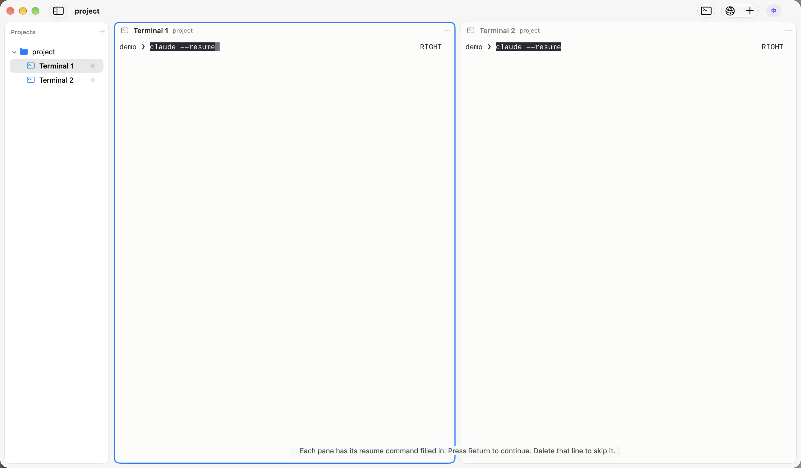
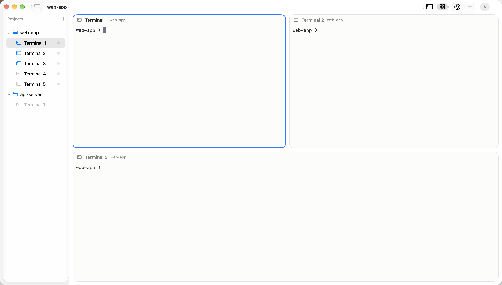
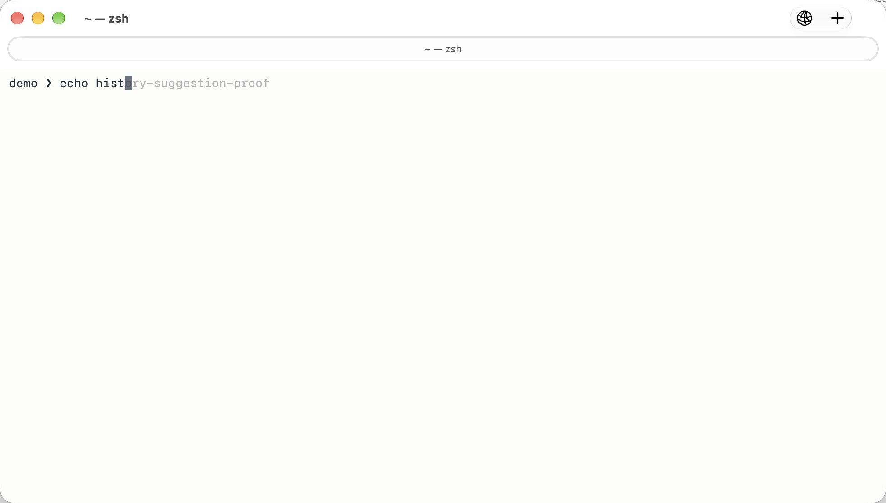

# User guide

[Documentation index](README.md) · [Project overview](../README.md)

🇺🇸 [English](USER-GUIDE.md) · 🇨🇳 [简体中文](i18n/zh-CN/USER-GUIDE.md) · 🇭🇰 [繁體中文](i18n/zh-Hant/USER-GUIDE.md) · 🇯🇵 [日本語](i18n/ja/USER-GUIDE.md) · 🇰🇷 [한국어](i18n/ko/USER-GUIDE.md) · 🇩🇪 [Deutsch](i18n/de/USER-GUIDE.md) · 🇫🇷 [Français](i18n/fr/USER-GUIDE.md) · 🇪🇸 [Español](i18n/es/USER-GUIDE.md) · 🇧🇷 [Português](i18n/pt-BR/USER-GUIDE.md)

Everything Corta does, and how to reach it. Each section says where the
feature lives — a menu, a shortcut, a setting — and links to the reference
that holds the details. Shortcuts are the defaults, and all but Find Next
and Find Previous can be changed ([Keyboard shortcuts](#keyboard-shortcuts)).

- [Install and update](#install-and-update)
- [Coming from another terminal](#coming-from-another-terminal)
- [Windows, tabs and panes](#windows-tabs-and-panes)
- [Text, fonts and themes](#text-fonts-and-themes)
- [Personalizing the terminal](#personalizing-the-terminal)
- [When a session ends](#when-a-session-ends)
- [Scrollback, search and selection](#scrollback-search-and-selection)
- [Links and file references](#links-and-file-references)
- [Shell integration](#shell-integration)
- [The working directory](#the-working-directory)
- [Directory suggestions (zsh)](#directory-suggestions-zsh)
- [History suggestions (zsh)](#history-suggestions-zsh)
- [Remote work: SSH and SFTP](#remote-work-ssh-and-sftp)
- [Images in the terminal](#images-in-the-terminal)
- [The command palette](#the-command-palette)
- [The Quick Terminal](#the-quick-terminal)
- [macOS integration](#macos-integration)
- [Speed and battery](#speed-and-battery)
- [Settings and the config file](#settings-and-the-config-file)
- [Keyboard shortcuts](#keyboard-shortcuts)
- [When something goes wrong](#when-something-goes-wrong)

## Install and update

Corta needs **macOS 26.0 or later**, **Apple silicon** and a **Metal 4-capable
GPU**. A virtual machine with a paravirtual GPU cannot render the terminal.
Download the `.dmg` and its `.sha256` file from
[GitHub Releases](https://github.com/noah-qin/Corta/releases/latest), keep
both in the same folder, and check the checksum there before opening the
image (replace `x.y.z` with the downloaded version):

```sh
shasum -a 256 -c Corta-x.y.z.dmg.sha256
open Corta-x.y.z.dmg
```

Drag Corta into Applications, then eject the image. Releases since 1.1.9
are disk images; 1.1.8 and earlier keep their original ZIPs.

Official releases are Developer ID-signed and notarised. If macOS rejects
a download, follow [Troubleshooting](TROUBLESHOOTING.md#installing). Launched from anywhere else, Corta offers to
move itself into `/Applications` (`suggest-applications-folder`).

**Updates.** **Corta ▸ Check for Updates…** checks now; a background check
runs once a day unless `update-auto-check = false`. An update is only
installed when you say so.

## Coming from another terminal

Corta has no importer: it reads one text file, `~/.config/corta/config`, and
the Settings window edits the same file. Most habits carry over through a
handful of keys. The left column names where the habit lives elsewhere; the
right is the Corta key ([Configuration](CONFIGURATION.md) has each one's
values and when it applies).

| If you relied on… | In Corta |
| :--- | :--- |
| ⌥ as Meta / Alt (iTerm2's *Left Option key: Esc+*, Ghostty's `macos-option-as-alt`) | `option-as-meta = true`. Off by default, so ⌥ types `é`, `ø` and `–` as macOS does. |
| Copy on select | `copy-on-select`, **on** by default. Set `false` for ⌘C only. |
| A hotkey window or quick terminal | `quick-terminal = true`; the key is `quick-terminal-key` (default ⌥Space). Off by default: a global hotkey is claimed in every application. [The Quick Terminal](#the-quick-terminal). |
| Programs copying to the clipboard over `ssh` or from `tmux` (OSC 52) | `allow-clipboard-write = true`. Off by default; reading the clipboard is not possible under any setting. |
| Being asked before closing a busy window | `confirm-close`, on by default. |
| Windows reopening where you left them | `restore-windows`, on by default. Layouts, tabs and working directories come back; processes and terminal text do not. |
| Your own colour scheme | A theme defined in the file (`theme.<name>.*`), or **View ▸ Theme editor…**. [Creating and editing themes](#creating-and-editing-themes). |
| Your own key bindings | `bind.<command> = <shortcut>`. The command names are in [Keyboard shortcuts](#keyboard-shortcuts). |
| A font of your choice | **Settings ▸ Appearance ▸ Font**, or `font-family`. Only monospaced families Corta can lay out on its grid are offered. |
| Ligatures, transparency or per-profile settings | Not available; they are [not shipped](CONFIGURATION.md#6-what-is-deliberately-not-configurable), and each needs a decision first. Presets cover a shell, a directory and an environment ([Presets](CONFIGURATION.md#4a-presets)). |
| `tmux -CC` control mode | Not supported (D09). Ordinary `tmux` runs inside Corta as any program does. |

**Shell integration.** Standard local zsh sessions load Corta's hooks
without touching your startup files. If your `~/.zshrc`, `~/.bashrc` or
`config.fish` still sources another terminal's integration — iTerm2's,
WezTerm's, Visual Studio Code's — **Settings ▸ Terminal ▸ Shell Integration**
says it may conflict; the two can both emit prompt marks. See
[Shell integration](#shell-integration).

**`TERM`.** Corta announces `xterm-256color` (D08). A remote host that
already works with iTerm2 or Terminal.app needs nothing new; one set up for
`xterm-ghostty` or `xterm-kitty` gets the common value instead.

Behaviour that differs in smaller ways — copying, closing, the Quick
Terminal hotkey, remote badges — is collected in
[Troubleshooting → Behaviour that differs](TROUBLESHOOTING.md#behaviour-that-differs-from-other-terminals).

## Windows, tabs and panes

| To… | Use |
| --- | --- |
| Open a window / a tab | ⌘N / ⌘T |
| Previous / next tab | ⇧⌘[ / ⇧⌘] |
| Rename the current tab | Double-click the tab title, or right-click ▸ Rename Tab… |
| Split the pane to the right / downwards | ⌘D / ⇧⌘D |
| Move focus between panes | ⌥⌘ + arrow key |
| Resize the focused pane | ⌃⌘ + arrow key |
| Fill the window with one pane, and back | ⇧⌘↩ (Zoom Pane) |
| Make every pane the same size | Equalize Panes (command palette) |
| Close the pane, tab or window | ⌘W |
| Put back the pane you just closed | ⇧⌘T |

- Rename a tab directly in its title: double-click, or choose Rename Tab…
  from its right-click menu. Return saves, Esc cancels, and an empty name
  restores the automatic title. Custom names survive shell output and session
  restoration. The tab and terminal right-click menus also offer New Tab, and
  the toolbar's **+** button opens one whether or not the tab bar shows; the
  tab bar has no **+** of its own.
- **Zoom Pane** is temporary: nothing closes and no process is disturbed.
- **Reopen Closed Pane** restores the pane's place, size and working
  directory — not the program that was running in it.
- Closing a pane with a command still running asks first
  (`confirm-close`).
- **Restoring windows.** Quit and relaunch, and every window comes back
  with its tabs, splits, divider positions and each pane's working directory
  (`restore-windows`, on by default). Each pane starts a fresh process;
  terminal text and running jobs are not restored. The Quick Terminal is excluded.
- **Presets.** A preset is a named shell, directory and environment,
  defined in the config file. **Shell ▸ New Pane with Preset** opens one;
  hold ⌥ to open it in a window of its own
  ([Presets](CONFIGURATION.md#4a-presets)).
- New windows open at `columns` × `rows` cells (120 × 30 by default).

### Space: projects side by side

Space keeps a project's terminals together — a shell for Git and builds, an
SSH session on the server, an agent CLI or two — with up to six on screen at
once. Switch with the grid button beside Connect and **+** in the toolbar (in
Space it shows a terminal, and takes you back), **View ▸ Show Space** (⌥⌘S)
or **File ▸ Open Project…** (⌘O). Space fills the screen; the terminal mode
gets its own window size back, and its tabs and splits are exactly as they
were, still running.

- **A project is a folder.** Add one with **+** beside *Projects* or ⌘O. Its
  first session starts there. Nothing is read from or written into the folder.
- **New sessions.** The toolbar's **+** (or ⌘D) starts a shell in the project
  folder; the globe connects over SSH into the same project. Run `claude`,
  `codex` or anything else in them as in any terminal.
- **The grid is yours to split.** A new session splits the roomiest panel
  along its longer side. Drag a session — a sidebar row or a panel's header —
  onto a panel: near an edge it splits that panel on that side (the half it
  will take is shown as you drag), in the middle it takes the panel's place
  (two panels on screen swap). Drag the gaps to resize. No split leaves a
  panel smaller than 64 × 18 cells; with no room, or at the limit, a session
  takes the place of the panel you used least recently, never the one you are
  typing in.
- **Columns or rows.** A tiled grid shares one axis: in rows each row has its
  own widths, in columns each column its own heights. **View ▸ Arrange in
  Columns / Arrange in Rows** (also in each panel's **…**) switches; ⌘Z undoes.
- **Choosing is not showing.** Clicking a session on screen focuses its panel.
  Clicking a hidden one only selects it; the grid changes when you ask: the
  add button at the end of its row (it appears on hover, and says what it will
  replace or join), ⌘Return, **Show in Grid** or **Show in Panel ▸** in its
  context menu, or a drag. Each placement outlines the panel once, shows a
  note with **Undo**, and can be undone with ⌘Z — the layout comes back, every
  process keeps running.
- **Names and kinds.** A session is named by its program — an agent's own
  name, the SSH host, the command running — or *Terminal N* at a prompt.
  Double-click its row, press Return on it, or choose **Rename…** to give it
  your own name; programs never change that one. Its icon is a terminal, a
  server for SSH, or sparkles for an agent CLI.
- **Panel actions** are in the **…** at each panel's corner (faint until you
  point at the panel) and on the header's context menu: **Fill Grid**, **Hide
  Panel**, **Rename…**, **Browse Files on This Host…** for a remote session,
  **End Session…**. Double-click a header to fill the grid, and again to
  return (also ⇧⌘⏎). A hidden session keeps running, at the size of the grid.
- **The sidebar** lists every project and every session. A coloured dot is a
  session's state — green running, orange waiting for you, red error, blue
  done — whether its panel is on screen or not, and a project's count says how
  many of its sessions wait on you. Hide it with the toolbar button or
  **View ▸ Hide Sidebar** (⌃⌘S).
- **Remote files.** *Browse Files on This Host…* opens the SFTP browser at the
  directory the remote shell is in. A project's **Remote Files ▸** lists the
  hosts its sessions connected to through the connect dialog (an `ssh` typed at
  a prompt is not listed). Drag a file from that browser onto a terminal on the
  same host to type its path there, quoted; nothing runs until you press
  Return, and other terminals do not take it.
- **After a restart** Space lists the same projects and, for each, starts the
  same sessions again — a shell in the directory it was in, the same preset,
  the same SSH host, which asks for its password again — the first time you
  open the project, in the same grid. Scrollback is not kept. For local Claude
  (`claude` or `claude-code`) and Codex, each pane remembers which tool was
  running, even after it exits. The baseline fills `claude --resume` or
  `codex resume`: press Return, then choose the conversation in that tool's
  official picker. npm Codex 0.165.0 has verified picker recovery; its TUI did
  not expose an attributable open rollout file. Shared app-server ownership
  remains unverified. When a UUID can be reliably attributed to that pane, it
  instead fills `claude --resume <UUID>` or `codex resume <UUID>` for that exact
  conversation. Two panes in the same directory keep their own identities;
  neither uses the directory's newest conversation, `--continue` or `--last`.
  The accelerators are undocumented and may stop working after a CLI update;
  the picker remains available. Claude uses its verified process session record;
  Codex uses its foreground group's open files. If Codex's shared background
  app-server owns the file, it cannot be attributed reliably and uses the picker.
  **Resume Source** in each pane's menu shows `sessionRecord`, `openFile` or
  `picker`. With no recorded kind, nothing is filled. SSH, remote agents and
  SFTP are excluded. Preset commands are unchanged. A busy prompt, or one with text at
  the cursor, is left alone. A prompt's right-hand side (RPROMPT, Starship,
  Powerlevel10k) is not text you typed: Corta waits until that line has stopped
  changing, then fills, and tries a few more times if the write does not land.
  **Fill Conversation Again** in the pane's menu fills the same command again
  at an empty prompt, without executing it.

### Keep Space SSH programs running after disconnecting

In Space's connect dialog, **Keep running after disconnect** defaults to on.
Each terminal gets its own `corta-<UUID>` session in the remote host's existing
tmux. Closing a panel, window or Corta disconnects only local SSH; reconnecting
that same terminal attaches to its still-running programs. No CLI conversation
resume command is sent. After restarting Corta, the project connects its saved
sessions, including hidden ones, only when first opened. Before that it makes
no connection. Turn retention off for ordinary SSH. The traditional terminal
mode, typed/nested SSH, custom presets and SFTP never get this wrapper.

Supported remote login shells are POSIX-family shells, zsh, fish and csh/tcsh.
The fixed wrapper is a single quoted line passed to `/bin/sh`, so csh/tcsh
can parse it before `/bin/sh` runs it. Nushell and other shells are untested.

The panel's glass connection button keeps its result visible even after tmux
clears the screen; click it for details and the exact tmux name:

- **tmux · Reconnectable**: the named remote session exists.
- **Ordinary SSH · Limited recovery**: remote tmux was not detected. Corta
  checks only the PATH supplied by sshd; it does not source remote shell
  startup scripts. An installation added only in `.zshrc` is not detected.
  Put tmux on that PATH and reconnect. This does not mean it is uninstalled.
- **tmux failed · Ordinary SSH**: creation or attachment failed; details show
  its exit status and up to 1,024 bytes of sanitised remote error text. A login
  shell is provided. Normal tmux detach (exit status 0) ends SSH instead.
- **Original session ended · New terminal**: a previously established tmux
  session is gone. The new terminal does not restore its former programs.

**End Remote Session…**, separately confirmed in the panel or sidebar menu,
terminates only that UUID with `tmux kill-session -t '=corta-<UUID>'`. Its new
terminal shows authentication and the result. Cancel runs nothing. Ordinary
close and removing a local session/project never kill tmux; removal warns that
it may keep consuming remote resources and gives the manual cleanup command.
The warning is a sheet on the Space window, or a dialog when that window
cannot show a sheet; Cancel leaves the session in place. If a saved UUID was
replaced because the file listed it twice, the warning also lists the previous
`corta-<UUID>`.

A server restart or an ended tmux session loses those processes permanently.
`destroy-unattached on` can destroy the session when SSH disconnects; Corta
does not change it. Screen/history are maintained remotely and subject to the
server's history limit. Two clients using the same UUID share a session and
compete over its size. Without `allow-passthrough`, directory and program-state
reports may not reach Corta; tmux status integration is not promised. Corta
changes no global tmux settings, installs nothing and starts no local daemon.

A brief Liquid Glass note at the grid's foot explains a successful fill,
without showing the UUID or offering Undo. Only successful fills count:

- One, exact conversation: “This conversation is filled in. Press Return to continue. Delete the line to skip it.”
- One, picker: “The resume command is filled in. Press Return, then choose the conversation to continue. Delete the line to skip it.”
- More than one: “Each pane has its resume command filled in. Press Return to continue. Delete that line to skip it.”
- A session filled while hidden, when shown with that exact input still at the same prompt: “Press Return to continue this conversation.”

The note disappears after a few seconds; the command stays in the prompt.



`space-panel-limit` (1–6) caps the panels on screen.



## Text, fonts and themes

- **Font.** Settings ▸ Appearance ▸ Font lists System Monospaced (the
  default) and every installed monospaced family Corta can lay out on its
  grid, in two groups: Apple Fonts (shipped with macOS, or Apple's
  on-demand fonts once downloaded in Font Book) and Installed by You. The
  line under the menu says where the chosen font comes from and whether
  it brings its own CJK characters — such a family draws letters and
  symbols in its CJK design too, a raised `~` for example. `font-family`
  in the config file is the same setting. `font-size` is 13 pt by default,
  10–24 pt in whole points. The page previews the font, colors and cursor.
- **Weight and line spacing.** Weight is Light, Regular (the default) or
  Medium; a font without that weight uses its Regular, and bold text is
  always the font's own bold. Line spacing is 1.0–1.4 times the font size,
  1.18 by default; a font that needs a taller line keeps it, so nothing is
  clipped. Every character in every language shares one cell size and one
  baseline.
- **Characters the font lacks.** Chinese, Japanese and Korean come from
  macOS's own fonts: Han from PingFang SC, PingFang TC, Hiragino Sans or
  Apple SD Gothic Neo by your system language, kana from Hiragino Sans and
  Hangul from Apple SD Gothic Neo whatever the language. To draw them in
  a font of your own — Menlo for letters and Sarasa Gothic or LXGW WenKai
  for Chinese, say — choose it under **CJK Font** (`font-family-cjk`). Any
  installed font with Chinese, Japanese or Korean characters is listed,
  monospaced or not: it draws only those characters, centred in their two
  cells, and the main font keeps the cell size. Emoji come from
  Apple Color Emoji — or, with Emoji set to Monochrome Where Possible, as a
  text glyph where Apple Symbols or Menlo has one. A wide character is
  centred in its two cells. Turn off **Use other fonts for missing
  characters** to see only the chosen font, with a box where it has no
  glyph.
- **Ambiguous-width characters.** Settings ▸ Terminal ▸ Ambiguous-Width
  Characters makes `±`, `§`, Greek, Cyrillic and the other East Asian
  Ambiguous characters two cells wide, for software written for CJK
  terminals. It applies to output written afterwards; a shell or editor
  that measures text itself may still count them as one.
- **Underlines.** Programs can draw single, double (`SGR 21` or `4:2`) and
  curly (`SGR 4:3`, Neovim's diagnostics) underlines; dotted and dashed draw
  single. Blinking text (`SGR 5`) is kept but not animated.
- **Zoom.** ⌘= / ⌘− / ⌘0 or a pinch make the text bigger, smaller or
  the configured size again, in the current window only. Zoom never
  changes the config file. Font changes never move or resize the window: the visible rows and
  columns refit to it, and what is left of a cell shows as background under the last row.
- **Theme.** Three built-in themes, `corta`, `solarized` and `mono`, each with light and dark variants;
  `appearance = auto` follows macOS as it switches. You can define your
  own theme through **View ▸ Theme editor…** or in the config file, or inherit
  from one and change a few
  colours ([Themes](CONFIGURATION.md#4-themes)).
- **Unicode.** Chinese, Japanese and Korean text takes two columns and
  lines up with everything else; emoji, combining marks, flags and emoji
  sequences are one cluster each. Characters the font lacks come from the
  system's fallback fonts. Standardized emoji presentation sequences (a text character followed
  by VS16, like ⚠️ or ✍️) take two columns; text presentation stays narrow.
- **Input methods.** Pinyin, Kana, Hangul and every other macOS input
  method compose in place, with the candidate window beside the cursor.
- **True colour.** 24-bit colour, the 256-colour palette, bold, italic,
  underline, strikethrough, dim and reverse.
- **⌥ as Meta.** Off by default, so ⌥ types the layout's characters. Set
  `option-as-meta = true` for Emacs-style Meta keys.
- **Bell.** A flash of the pane (`bell = visual`), or a sound
  (`bell = audible`).

## Personalizing the terminal

### Cursor appearance

Open Settings (⌘,) → Appearance → Cursor. Choose Block, Bar or Underline,
then enable Blink cursor if desired. The default is **Block, blinking off**.
The three shapes and independent switch provide six combinations. These are also `cursor-shape` and
`cursor-blink` in the configuration file. Changes apply to open panes.
Terminal programs can temporarily choose their own shape and blinking through
DECSCUSR; parameter 0 or a terminal reset returns to your configured defaults.
Blinking pauses when a pane is inactive, hidden or showing scrollback.

### Input-source indicator

The focused terminal shows a small badge in the window’s upper-right toolbar:
`A` for confirmed direct input, `中` for Chinese, `あ` for Japanese and `한`
for Korean. Other sources use their language code. Hover for the full source
name. A neutral badge identifies sources whose internal input mode is not
reported by macOS, including third-party IMEs with private English toggles.
Corta never guesses that mode from typed text and never changes the input source.

Settings ▸ Keyboard & Mouse ▸ Input Source Indicator chooses **Automatically**
(default), **Always in focused pane**, or **Off**. The default only
enables the indicator for users with an enabled non-Latin keyboard layout or
an IME; Latin-only keyboard setups remain uncluttered. Switching back to a Latin
layout keeps a quiet `A` on a faint background — gray in the toolbar, the
theme's own text colour beside the prompt. Non-Latin layouts and built-in IME
modes use a soft indigo tint; unknown IME modes use gray. Beside the prompt,
colours follow the terminal theme's darkness rather than macOS's. In the
toolbar the badge stays while a program runs — Claude Code, an editor — since
it covers no output. At the right edge of the command line, shell integration
hides it during command execution in **Automatically** mode. **Always**
can keep it during command output. Both prompt modes hide it while reading
scrollback or using an alternate-screen program.

The **Position** setting chooses **Window toolbar** (default) or **Right edge
of command line**. The toolbar badge sits independently of the Connect and
New Tab buttons and stays fixed as commands grow or wrap. Turning it off or
choosing command-line placement removes its toolbar slot and separating space.
With command-line placement, long commands move the badge down to free space,
keeping it at the right edge;
it hides when no safe row remains and never inserts a line or scrolls the child.
Direct-input and IME colors accept hex values; clear a field for the subtle default styling.

[Chinese input-source badge](brand/input-source-indicator.png) ·
[Long-command avoidance](brand/input-source-long-command.png)

### Optional local system status

Open Settings (⌘,) → Terminal, enable Bottom status bar, then select the
metrics you want to see: CPU usage, system load,
memory usage, network rates, disk free space and thermal state. It is off
by default; each metric has its own toggle. Click the bar to see the local
host's name, macOS version, chip, core count and total memory. The bar says
Local even in an SSH pane; it does not monitor a remote server. In narrow
windows, click for the full selected metrics.

The network interface defaults to auto. It measures one primary interface,
so VPN traffic is not added to physical traffic. Enter a specific interface
name in Settings to measure it instead. Sampling stops while every enabled
bar is hidden. Thermal state is a four-level macOS report, not degrees.

The bar uses compact labels, a single-space separator and short byte
units; full names and precision are in its tooltip, its accessibility
value and the host-details popover.

### Creating and editing themes

Settings → Appearance → Create theme opens a graphical editor. Name your
copy, switch between dark and light variants, and change colors using color
pickers or HEX values. The preview updates without changing terminal windows.
Save theme activates and persists it; Cancel keeps your previous theme.
Custom themes offer Edit theme. Restore source colors resets the current
variant. You can still edit the same config file by hand. If that custom theme
changes outside the editor, reopen the editor before saving.

View → Theme editor opens graphical color editing directly. View → Local host details
shows host configuration without requiring the optional status bar. The same
host-details button is available in Settings → Terminal. Appearance previews
follow explicit mode changes immediately and show the selected cursor shape
and blink state. Terminal programs can still temporarily override cursor style.

### Compact Tab indentation (zsh)

Standard local zsh sessions load the bundled hooks automatically when
Directory suggestions or History suggestions is enabled (both default to on). You do not need to modify
your startup files. If you use custom zsh arguments or have turned off that
automatic bootstrap, install or update Shell Integration in Settings →
Terminal, then open a new shell. With those hooks loaded, Tab on a
whitespace-only command line inserts four spaces. Tab after command text retains the existing
completion binding. This is a ZLE widget; terminal output tab stops remain eight
columns, and full-screen programs continue receiving the Tab key. Without the
integration, the shell retains its own input-tab behavior.

### Language

The app follows macOS’s preferred language for Corta: English, Simplified and
Traditional Chinese, Japanese, Korean, German, French, Spanish and Brazilian
Portuguese. Restart Corta after changing its app-language preference in macOS.
Numeric formatting follows the current locale.

## When a session ends

A pane keeps its output after the shell exits: the output is dimmed a
little and a panel says what ended and how — the exit code, or the signal
that stopped it, in a sentence. The cursor disappears, but scrolling,
selection, copying and ⌘F search still work around the panel. **New
Session** starts the shell or preset again in the pane; **Close Pane**
closes it. A directly connected SSH session says which host it was
connected to and offers **Reconnect** to start a new connection; ssh's exit
code 255 is explained as the network dropping or the host not answering.
Either button clears the output above — the panel says so — and the new
session starts at the pane's size and font size. Exiting Python or another
program back to a live shell does not end the terminal session.

When a session's input or output fails, or a pane stops drawing, the same
panel offers **Try Again** or, for a connection, **Reconnect**; the system's
own error text is under **Details**.


## Scrollback, search and selection

- **Scrolling.** The trackpad or wheel, or ⇧PageUp / ⇧PageDown, ⇧Home /
  ⇧End. Each session keeps `scrollback-lines` of history (10,000).
- **Search.** ⌘F opens the search bar over the scrollback; ⌘G and ⇧⌘G go
  to the next and previous match. **Match Case** and **`*`** (regular
  expression) toggle there, and remember their state in the config file
  (`search-case-sensitive`, `search-regex`). The bar sits at the top right
  of the pane and moves to the bottom while the cursor or the current match
  would be under it; in a narrow split it narrows rather than covering the
  pane. Each pane has its own bar.
- **Selecting.** Drag to select, double-click for a word, triple-click for
  a line. A finished selection is copied at once (`copy-on-select`); ⌘C
  copies too. Inside a program that uses the mouse — `vim`, `htop` — hold
  ⌥ while you start dragging to select text anyway
  (`mouse-override-modifier`).
- **Paste.** ⌘V. Pasted text is marked as a paste (bracketed paste), so a
  shell that supports it — zsh, fish, bash 5.1 or later — inserts a pasted
  command without running it until you press Return. When the program has
  not turned bracketed paste on (macOS's own `/bin/bash` 3.2 never does),
  Corta warns before pasting text that contains a line break. It also warns
  for a pipe into a shell (or `bash <(curl …)` and its kin), sudo, recursive forced deletion, a backslash
  continuation, or invisible/bidirectional characters, even with bracketed
  paste enabled. Review the risk sentences and text preview before choosing
  **Paste** or **Cancel**; hidden characters appear as `⟦U+202E⟧` codes.
  **Don’t warn again for this pane** lasts until that pane closes.
  Set `paste-warning = always` to warn on every multiline paste, or `off`
  to disable these dialogs. These are conservative patterns, not a shell
  parser or a guarantee that other text is safe. A large
  paste the shell is still working through can be cancelled with ⌃C: the
  part not yet sent is dropped and the interrupt goes straight through.
- **Right-click.** The clicked pane offers Find… and Copy Command Output
  for the completed command whose output contains the clicked row; the copy
  item is disabled on prompts, on the alternate screen (full-screen programs)
  and without shell integration. On a link it
  offers Open Link and Copy Link; on a `path:line:column` reference it offers
  Open Path and Copy Path. Opening uses the same link checks, configured
  editor and remote confirmation as clicking. Programs with mouse reporting
  still receive right-clicks.
- **Export Text…** (⇧⌘S) saves the selection — or, with nothing selected,
  the whole scrollback and screen — to a file.
- **Clearing.** Three commands, because they discard different things:

  | Command | Screen | Scrollback | Modes and colours |
  | --- | --- | --- | --- |
  | Clear Screen (⌘K) | erased; ready shell prompt and input kept | kept | kept |
  | Clear History | kept | discarded | kept |
  | Reset Terminal | erased | discarded | reset |

  With shell integration, Clear Screen moves the ready prompt and its
  complete input to the top, keeping the editing cursor, wraps, colours and
  wide characters. It sends no keystrokes and never executes the input.
  A prompt still being printed, a running command, or a shell without ready
  prompt markers keeps the ordinary erase-and-home behavior. Alternate-screen
  programs such as vim are left intact; an editor whose prompt has scrolled
  into history is also left intact to avoid erasing part of its input.

  Clear History and Reset Terminal ask first and say how many lines they
  would discard — unless the scrollback is empty, or `confirm-close = false`
  turns the question off.

## Links and file references

- **URLs** show their target and the ⌘-click instruction on hover, and open with ⌘-click; set `link-activation = click` to open them
  with a plain click instead. Hold ⌘ over a link — including one a program
  marks explicitly (OSC 8, as `ls --hyperlink` prints) — to underline it
  and see its real target as a tooltip before you click; the click itself
  opens it at once.
- **File references.** A `path:line:column` in program output — a compiler
  error, a test failure — opens in your editor with ⌘-click. Tell Corta
  which editor with `open-file-command`, starting with the editor's full
  path, for example
  `open-file-command = /usr/local/bin/code --goto {file}:{line}:{column}`
  ([Following a file reference](CONFIGURATION.md#following-a-file-reference)).

Opening any file reference requires a configured `open-file-command`. Corta
never opens output-derived files in their system default application: some
file types run code when opened.

## Shell integration

Shell integration lets Corta see where each command starts and ends. Install
it from **Settings ▸ Terminal ▸ Shell Integration**: it adds one marked block
to your shell's startup file — `~/.zshrc`; for bash both `~/.bashrc` and
`~/.bash_profile` (or whichever login file bash reads); or
`~/.config/fish/config.fish` — and **Remove** takes out exactly that block.
The startup-file block is only installed when you press the button. Standard
local zsh sessions also load Corta's bundled hooks automatically, without
editing your startup files, when **Directory suggestions (zsh)** or **History suggestions (zsh)** is enabled
(the default). Custom zsh arguments, bash, fish and remote shells do not
use this automatic bootstrap. Install compatible hooks in those shells to
enable command boundaries there.

When Settings reports an outdated integration, choose **Update** and open a
new shell. Updating the app alone does not replace a previously installed
startup-file block.

With the hooks loaded, automatically or through startup-file installation:

- **Prompt marks.** A thin rule at the left of each prompt, green when the
  command succeeded and red when it failed. An empty Return draws no rule
  and creates no completed command-history entry.
- **Jumping.** ⌘↑ / ⌘↓ move between commands, and also stop at marks a
  program sets with iTerm2's `OSC 1337;SetMark`; ⇧⌘↑ / ⇧⌘↓ move between
  the ones that failed.
- **A command's output.** From the command palette: **Copy Last Command
  Output**, **Snapshot Running Command's Output** (what a build has printed
  so far), **Export Command Output…** to a file, and **Open File Reference
  in Command Output**, which opens the last `path:line` it printed.
- **Command History.** **Search Command History…** lists every command
  with its time, exit status and directory; **Fill** puts one back at the
  prompt and **Run** runs it again (`command-history-limit`). A command the
  list cannot show whole — more than one line, cut off at the row's edge, or
  holding a tab — or one whose text changed since the list showed it is
  filled rather than run, so all of it is at the prompt and runs on your
  Return.
- **History and About windows.** Command History opens centered over the
  invoking window, kept within its display's usable area; **Corta ▸ About
  Corta** opens in the middle of that display, as other apps' About windows
  do. An already open window stays where you moved it. Command History's
  fixed size keeps the search and directory/project/status/host filters
  visible; an empty result shows **No Commands** and the result count.
- **Long-task notifications.** With `notify-on-long-task = true`, a command
  that ran longer than `notification-threshold` seconds (30) posts a
  notification when it finishes **while its window is not key**, provided
  macOS has granted Corta notification permission. Enable it in Settings ▸
  General and check the permission status there. Click the notification to
  jump to the command.

Without shell integration these commands are disabled rather than silently
doing nothing, and notifications fall back to a guess based on typing and
output.

## The working directory

Corta knows the directory your shell is in when the shell reports it (shell
integration does). From the command palette:

- **Reveal Working Directory in Finder** and **Copy Working Directory Path**.
- **Change Directory to Parent** and **Change Directory to Project Root**
  (the nearest folder with `.git`) type the `cd` for you — only when no
  command is running and the prompt is empty.
- **Open Parent Directory in New Pane** and **Open Project Root in New
  Pane** split the pane with a shell started there.

The folder icon in the title bar is the directory too: drag it, or ⌘-click
it to see the path. With `directory-history` on (the default), Corta records
the local directories your commands ran in. Nothing in the app lists them
yet; **Settings ▸ Privacy & Security ▸ History** shows how many there are
and clears them.

## Directory suggestions (zsh)

Corta includes directory suggestions, enabled by default in standard local
zsh sessions. Type `cd ` to see folders in the current directory in a
compact panel beside your input. It appears below the input when there is
room, or above it near the bottom of the pane. A rounded glass capsule with
a tinted background and border distinguishes it from earlier output;
it can temporarily cover a small part of that output and reserves no
terminal rows. Keep typing to filter the folders; a faint suffix
appears beside the cursor. For example, `cd De` can suggest `Developer/`.
Suggestions are previews: they are not part of your command until accepted.


While a suggestion is visible:

| Key | Action |
| --- | --- |
| Left / Right | Select the previous / next folder instead of moving the input cursor. |
| Tab | Fill the selected directory into the input; do not execute it. This replaces native Tab completion while suggestions are visible. |
| Esc | Dismiss suggestions for the current input. Press Esc before using Left / Right to edit the command, or again for the shell's own Esc action. With `bindkey -v` the same press also enters command mode. |
| Up / Down | Keep the shell's normal command-history navigation. |
| Shift+Tab | Pass through to the shell's configured binding. |
| Return | Execute only the actual input; never automatically accept a faint suggestion. |

You can filter relative paths, subdirectories and `~/` paths. After Tab
fills a folder ending in `/`, its subdirectories become the next candidates;
repeat to build a deeper path, then press Return when you want to run `cd`.
Only folders are offered, so a folder containing only files has no further
directory candidates. Hidden folders
appear when you type a dot prefix. Complex shell expressions keep native
completion. Bash and fish retain their own completion; suggestions appear
only in a shell Corta started with its automatic zsh hooks, never on remote
machines or in custom shell commands, even with Shell Integration installed.

**Optional: turn it off.** In **Settings ▸ Terminal ▸ Shell**, turn off
**Directory suggestions (zsh)**, or set this in your config file:

```ini
directory-completion = false
```

This immediately disables Corta's suggestions and key interception, leaving
the shell's native editing and completion available. Reopen the shell after
enabling it again. There is no startup-file block to delete for the automatic
local hooks. If you also installed shell integration manually, its **Remove**
button removes that separate startup-file block; removal is not needed to
turn off directory suggestions.

## History suggestions (zsh)

In a standard local zsh session, typing the start of a previous command
shows its remaining text faintly after the cursor. The most recent matching
single-line command wins. For example, after running `git status`, typing
`git st` suggests `atus`. The hint is only a preview until you accept it.



| Key | Action while the hint is visible |
| --- | --- |
| Right / End | Append the suggested suffix at the end of the input, without executing. |
| Esc | Dismiss the hint until the input changes. With `bindkey -v` the same press also enters command mode. |
| Tab / Shift+Tab / Up / Down | Keep the shell's normal completion and history bindings. |
| Return | Execute only the actual input. |

Empty input, a cursor in the middle of the line and multiline history entries
show no history hint. `cd ` keeps directory suggestions while they are on,
and gets history hints when they are off. Input-method composition hides
hints, leaving the IME's own candidates available.
If zsh-autosuggestions is loaded, Corta leaves history suggestions to it.
Bash, fish, remote shells and custom startup commands keep their own editing.

The default is on. Disable **Settings ▸ Terminal ▸ Shell ▸ History suggestions
(zsh)** or set `history-suggestions = false` to hide hints and restore native
keys immediately. Reopen the shell after enabling. Directory suggestions
have their own toggle. Both use temporary startup wrappers and leave your
startup files unchanged. Corta uses zsh's in-memory history, never reads
`HISTFILE`, and never logs or saves suggested text. Suffixes longer than 128
Unicode characters are omitted.

## Remote work: SSH and SFTP

Corta uses the system's OpenSSH — your `~/.ssh/config`, keys, agent and
`ProxyJump` all apply — and has no SSH implementation of its own.

- **The host badge.** A pane connected to another machine shows
  *Remote:* at the front of the window title. It names the host and folder
  when the remote shell reports them (shell integration installed there),
  and the destination you typed when the connection came from the connect
  sheet; otherwise it says the pane is remote without knowing which host.
- **Reconnect.** When an `ssh` or `mosh` session ends, **Reconnect to Host**
  runs the same command again, as a new connection.
- **Connecting.** The toolbar's globe button opens **Connect to Host**, a
  sheet with a **Terminal / Files (SFTP)** switch: a terminal over SSH, or
  the file browser. Type the host — a name, an address, `user@host` or an
  SSH alias. The host field, mode switch, suggestions and buttons use rounded
  glass surfaces. In a small window the sheet scrolls to keep all fields and
  actions reachable. **Advanced** holds the user, the port and a private key;
  leave them empty and your `~/.ssh/config` and OpenSSH's defaults decide
  them. A chosen key is offered first, and other keys in `ssh-agent` are
  not tried. The sheet lists the connections you made recently — with the
  port, key and when you last used them — and the `Host` names in your
  `~/.ssh/config`. Hosts that only take git (`github.com`, or a `Host`
  with `User git`) are left out, and the list says which. Type to narrow
  the list, click one (or use ↑ and ↓ from the host field) to fill the
  fields, double-click or press Return to connect. A terminal connection
  joins the recent list once it is established — a host that refuses you,
  or has no shell, does not. Hover over a recent host and click ✕, or
  right-click it, to forget it; Settings ▸ Privacy & Security ▸ Recent
  Hosts clears them all.
- **This pane's files.** Opened from a pane connected to another machine,
  the sheet offers that host's files first; press Return or **Browse
  Files** to open them.
- **Browse Remote Files…** opens an SFTP browser for the pane's host: list,
  upload, download, rename and delete. The first connection to a host asks
  you to confirm the host name. Transfers resume after an interruption and
  never overwrite a file without asking.
  A folder download stops if a name conflicts with a `.corta-part` staging
  file, preserving the existing file. Choose a separate destination or resolve
  that file individually; a folder-wide overwrite cannot consume a partial.
- **In the browser**, as in Finder: ⌘[ and ⌘] go back and forward, ⌘↑ to
  the enclosing folder, ⌘R refreshes, ⇧⌘G (or a click on the path) types a
  path, ⇧⌘N makes a folder and ⇧⌘. shows hidden files. Click a column title
  to sort. Right-click a row for its actions; double-click a folder to open
  it. Drop files from Finder on the listing — or on a folder row — to upload
  them; while you drag, the listing (or the row) is outlined and says where
  the files will go. Drag a file out to Finder to download it. The same drag offers an
  `sftp://user@host:port/path` link to URL or text destinations, without
  downloading; user and port appear when specified for the connection.
  The link contains no password or private-key path. Dragging and waiting
  for a download leave the browser responsive. Transfers are under
  the toolbar's arrows button, with speed, time left and Show in Finder.
- **Editing a remote file.** **Edit** in the browser — or ⌘-clicking a
  `path:line` in a remote pane — downloads a copy and opens it in your
  editor. Set **Settings ▸ Terminal ▸ Open File Command** first, using an
  absolute editor executable and `{file}`, `{line}`, `{column}` placeholders
  ([examples](CONFIGURATION.md#following-a-file-reference)). Uploading your
  changes is a separate, explicit step, and Corta
  checks first whether the remote file changed meanwhile. Files over 64 MiB
  are not copied this way; download them from the browser, which shows
  progress and can cancel. A copy nobody has opened or changed for 30 days is
  removed the next time remote editing is used; one with changes you have not
  uploaded or dismissed stays.
- **Names.** A remote name holding control, right-to-left or zero-width
  characters shows them as `�`, and a download saves them as `_`, so a name
  cannot pass for another one.

When the server asks for a password, a key passphrase or a one-time code,
or when a host is new and its key needs your decision, the browser asks in
a dialog on its window and hands your answer to OpenSSH; nothing is saved,
so a reconnect asks again. **Cancel Connection** in the password dialog
ends that connection attempt and returns to the host field — it is not
sent as an empty password. **Cancel** on a key's passphrase skips that key,
and ssh goes on to the next way of signing in. The host-key dialog shows
the fingerprint and defaults to Cancel. A key held by `ssh-agent` or the
keychain, or an existing `ControlMaster` connection from your terminal,
signs in without asking.

A connection that fails says why in a sentence — the password or key was
not accepted, the host did not answer, its host key is unknown or changed,
the server offers no SFTP — with ssh's own words under **Details**, and
offers **Try Again** or **Edit Connection**.

Remote-edit uploads compare remote content as well as size and modification
time and send the private snapshot you approved. If you save another local
edit after the approval prompt, Corta asks for a new decision; saves during
an upload remain pending. After a connection failure, the next edit or
upload connects again, and a failed upload keeps its pending decision.
Once connected, an operation that has not finished after 120 seconds is
stopped and the upload offered again, so a stalled connection cannot hold
an edit forever.
Preserve undecided local edits before deleting application data. See
[data-at-rest policy](SECURITY.md#5-data-at-rest).

## Images in the terminal

Programs that speak the **kitty graphics protocol** can show images inline:

```sh
kitten icat --transfer-mode=stream picture.png
```

Images scroll with the text, stay in the scrollback, and are removed by
Clear Screen or Clear History along with the text around them. Inside a
program's scroll region — a full-screen program's pane, say — an image moves
with the region's text and is cropped where it scrolls past the region's edge.
An image may be up to 8192 pixels on a side and 16 million pixels in all. Other tools
that support the protocol, such as `timg` or `chafa`, can use it too, as
long as they send the image itself: Corta refuses by design to read a file
path a program names, and animation is not supported. A picture larger than the
pane is scaled to fit it.

## The command palette

⇧⌘P opens the command palette: every command Corta has, searchable by
name, with its shortcut beside it. Type a few letters and press Return.
Letters match in order, not necessarily together (`spr` finds Split Pane
Right); a group's name (`panes`) or a command's configuration name
(`new-tab`) finds it too. Commands you ran recently are listed first.
Clicking another window closes the palette and leaves that window in front.
It is the quickest way to reach the commands that have no default shortcut.

## The Quick Terminal

A terminal that drops down over whatever you are doing. Open it from
**View ▸ Quick Terminal**, from the command palette, or with a system-wide
hotkey once you turn one on:

```ini
quick-terminal = true
quick-terminal-key = alt+space
quick-terminal-position = top      # top, bottom or center
```

The hotkey is off by default, because a system-wide key is taken from
every other application.

## macOS integration

- **Shortcuts.** Three actions: **Open Corta Window** (optionally in a
  folder), **Focus Corta Window** and **Toggle Quick Terminal**. None of
  them runs a command in a shell.
- **Services.** Selected terminal text is offered to the **Services** menu.
- **Secure Keyboard Entry.** **Shell ▸ Secure Keyboard Entry** stops other
  applications from reading your keystrokes while Corta is in front — for
  typing passwords. A lock in the title bar shows when it is actually on.
- **VoiceOver** reads the terminal's text and follows the focused pane.
- **Clipboard from programs.** Off by default. With
  `allow-clipboard-write = true`, a program — including one inside `tmux`
  or over `ssh` — may put text on your clipboard (OSC 52). Nothing may read
  it back.

## Speed and battery

Corta does the fast thing on its own; nothing here needs a setting. This is
what it does, so you know what to expect.

- **Typing gets the panel's full refresh rate.** While you type, paste or
  compose with an input method, Corta asks for the display's maximum frame
  rate — 120 Hz on a ProMotion panel — and lets it settle a second after the
  last key. Low Power Mode, an inactive window and thermal pressure lower the
  ceiling again when you are not typing; critical thermal pressure always
  does.
- **Full screen with one pane can reduce latency on macOS 27 or later.** Corta
  then presents its frames straight to the display, skipping the window
  server's compositor: about one frame less from keypress to glass on the
  measured Mac. A split, the find bar or anything else drawn over the text
  brings the compositor back while it shows. On macOS 26, every window uses
  the classic-queue copy path as a compatibility measure for a WindowServer
  crash (#380); the latency figures above were not
  measured on that OS. (`CORTA_DIRECT_FULLSCREEN=0` in the launch
  environment disables the full-screen changes, but not the macOS 26
  compatibility path.)
- **Output reading and display have separate paces.** The PTY reader
  continues parsing while the screen presents the latest state at the
  display's pace. A measured core-feed benchmark reached 317.3 MiB/s;
  that figure excludes PTY I/O, rendering and display and is not a promised
  speed for a real build log or `yes`.
- **Scrolling and full-screen programs redraw only what changed.** vim, less,
  tmux and a status line scroll by shifting what is already drawn.
- **Long scrollback stays small.** History is compressed in memory as it
  scrolls away — the measured memory increment for 100,000 lines of
  120 columns was about 11 MiB — and
  search, copy and resizing work on it directly.
- **Idle means idle.** A blinking cursor is animated by macOS rather than
  redrawn by Corta, an idle shell causes no periodic wakeups, and a window
  that is covered or minimized stops drawing entirely.
- **Hidden panes yield.** Two seconds after a pane is hidden — another tab,
  a minimized window — its output is read at background priority, so it
  does not compete with what you are looking at. Nothing is lost, and
  typing or pasting into it restores full priority at once.

[Performance](PERFORMANCE.md) has the measurements and how they were made.

## Settings and the config file

All settings live in one text file, `~/.config/corta/config`. **Corta ▸
Settings…** (⌘,) edits the same file, and editing the file by hand is just
as supported:

Settings is a sidebar of categories, the way System Settings is laid out:

- **General** — the new-window size, restoring windows, confirming close,
  long-task notifications and updates.
- **Appearance** — light or dark, the system monospaced font, size, and a
  live preview, cursor shape/blinking and graphical theme editing.
- **Terminal** — scrollback, the command-history limit, the bell, search
  defaults, the open-file command, shell integration, optional system status
  and local host details.
- **Keyboard & Mouse** — Option as Meta, how links open, the modifier that
  selects text while a program owns the mouse, copy on select and input-source
  indicator modes/colors.
- **Shortcuts** — every command's key; a reset arrow appears beside one you
  have changed.
- **Quick Terminal** — the system-wide hotkey, position and screen.
- **Connections** — Connect to Host, and saved presets.
- **Privacy & Security** — clipboard writes from programs (OSC 52), Secure
  Keyboard Entry, the directory history and recent hosts.

These controls edit the same config file. Custom theme colors can be edited
graphically or through the file.

The window toolbar's globe button connects to a host, for a terminal or
for its files: a sheet on the window with the host — it may be a config
alias — and the user, port and private key under Advanced, suggesting
recent and configured hosts; an empty user, port or key respects OpenSSH
configuration. From a remote pane it offers that host's files first
([Remote work](#remote-work-ssh-and-sftp)).

```ini
theme = corta
appearance = auto
font-size = 14
scrollback-lines = 20000
notify-on-long-task = true
bind.equalize-panes = ctrl+cmd+e
```

Most settings apply at once; a few (window size, scrollback length) apply
to the next window or session. [Configuration](CONFIGURATION.md) lists
every key, its default and when it takes effect.

## Keyboard shortcuts

Change any shortcut with `bind.<command>` in the config file; an empty value
removes it, and the keystroke then reaches the program in the terminal:

```ini
bind.equalize-panes = ctrl+cmd+e
bind.close =
```

**Help ▸ Keyboard Shortcuts** shows the ones in effect in aligned columns;
commands without a binding are labelled **Not Set**. The terminal context
menu shows the same configured shortcuts.

The **Shell** menu keeps splitting, reopening and Clear Screen directly
available. Other tools are grouped under **Move Focus**, **Commands and
Output**, **Working Directory**, **Pane Layout**, and **Terminal and
Connection**.

The defaults, as of this version — [Keyboard shortcuts](CONFIGURATION.md#5-keyboard-shortcuts)
is the authoritative list:

| Command | Shortcut |
| --- | --- |
| New Window / New Tab | ⌘N / ⌘T |
| Close | ⌘W |
| Split Pane Right / Down | ⌘D / ⇧⌘D |
| Move Focus | ⌥⌘ + arrow |
| Resize Pane | ⌃⌘ + arrow |
| Zoom Pane | ⇧⌘↩ |
| Reopen Closed Pane | ⇧⌘T |
| Bigger / Smaller / Actual Size | ⌘= / ⌘− / ⌘0 |
| Find… / Find Next / Find Previous | ⌘F / ⌘G / ⇧⌘G (Find Next and Previous are fixed) |
| Copy / Paste / Select All | ⌘C / ⌘V / ⌘A |
| Scroll a page / to the top or bottom | ⇧PageUp, ⇧PageDown / ⇧Home, ⇧End |
| Previous / Next Command | ⌘↑ / ⌘↓ |
| Previous / Next Failed Command | ⇧⌘↑ / ⇧⌘↓ |
| Export Text… | ⇧⌘S |
| Clear Screen | ⌘K |
| Settings… | ⌘, |
| Command Palette… | ⇧⌘P |

Every other command — Equalize Panes, Clear History, Reset Terminal,
Browse Remote Files…, the command-output and working-directory commands —
has no default key and is one search away in the command palette.
[Keyboard shortcuts](CONFIGURATION.md#5-keyboard-shortcuts) has the full
table with each command's `bind.` name.

## When something goes wrong

[Troubleshooting](TROUBLESHOOTING.md) covers what you see when something
fails and how to fix it — a download macOS will not open, a font that is
refused, a shortcut that does nothing. [Features and limitations](FEATURES.md)
lists what Corta does not do yet. Report anything else on
[GitHub Issues](https://github.com/noah-qin/Corta/issues/new/choose).
For usage questions, go to [Discussions → Q&A](https://github.com/noah-qin/Corta/discussions/categories/q-a),
or ask in `#help` on the [Discord](https://discord.gg/QNdWfdwr7j).

## Coding-agent state and program notifications

**Claude Code is currently the only CLI with a dedicated task-state
integration.** It was developed and acceptance-tested with the installed
**Claude Code 2.1.310** on macOS arm64; this is not a compatibility guarantee
for all Claude versions. Codex, Gemini CLI, pi,
Kimi, Grok Build, Qwen Code, OpenCode and Aider have no dedicated task-state
adapter in Corta. Generic notification/progress protocols remain available
to any program; process detection is not a full agent integration. See the
[compatibility scope and verification limits](CONFORMANCE.md#cli-signal-compatibility).

By default, agent panes distinguish Working (accent colour), Waiting for you (orange),
Done (green), Failed (red), Idle (grey), and State unknown (a hollow grey dot)
on their native tab. Idle means no active turn is reported, including before
work starts or after it stops; only an explicit `done` means completion.
A progress ring follows OSC 7501 or OSC 9;4 reports. The Dock counts waiting
panes and shows aggregate progress. Open the command palette or Window →
Agents to find every agent pane across windows; choosing an entry focuses it.
In the palette the agents are listed first while browsing and after matching
commands while searching, and Return still runs the highlighted command:
move to an agent with the arrow keys to jump to it.
Several agents in one pane are shown by their most urgent state. Status and
application names are reported by the program, not verified identities.
Generic OSC 21337 metadata can decorate the current state with an indicator
colour and a status label when its task title is empty. Without a task state,
its label remains State unknown. `status-color` is retained metadata; native
tab and menu text use the system colour. Claude Code 2.1.310 does not enable
this metadata channel.

Claude Code's OSC 7501 status probe needs no setting in an ordinary interactive
session. It requires Claude Code 2.1.295 or later; Corta's checked reference
is 2.1.310, not that entire version range. Status does not pass through tmux
by enabling `allow-passthrough`: Claude probes tmux itself. Claude's background
sessions do not report OSC 7501 even while attached; these differ from a
hidden Corta pane running an interactive session. Unset
`CLAUDE_CODE_DISABLE_TERMINAL_TITLE` to allow probing and reporting. See
[Anthropic's terminal requirements](https://code.claude.com/docs/en/terminal-config#see-session-status-in-your-terminal).
When a hidden Corta pane
asks permission, asks a question or needs sign-in, Corta posts a fixed message.
For Claude Code's own message text, set its `preferredNotifChannel` to
`ghostty` (OSC 777), `iterm2` (OSC 9), or `kitty` (OSC 99) in Claude's
`settings.json` or `/config` → Local notifications. `auto` does not select a
message channel for Corta. `terminal_bell` sends BEL, `iterm2_with_bell` adds
BEL to OSC 9, and `notifications_disabled` disables Claude's own notification
channel; it does not disable Corta's 7501 attention notices. Corta still
identifies itself as Corta. These Claude-specific protocol details are
based on the checked reference version; availability can depend on the
installed Claude version. Claude's explicit permission notices usually wait
about six seconds without typing; completion reminders usually wait about
60 seconds and require no running background agent. These are separate from
the immediate state reports. See [notification timing](https://code.claude.com/docs/en/hooks#notification).
OSC 9;4 parsing does not mean Claude emits progress in Corta: 2.1.310's
progress channel requires `terminalProgressBarEnabled` and a terminal it
recognises as supporting progress; Corta's normal identity is not selected.

Programs without status support are detected by foreground process name
(claude, claude-code, codex, gemini, aider, opencode); add names with
`agent-processes = my-agent,another-agent`. These panes show State unknown
while the process is active: output and prompt redraws do not prove a task
is working. A return to the shell or a clean process exit means Idle, not
Done; a known failed exit is Failed. Notifications and BEL request attention
without changing the task state. Silence alone does not mean completion.
BEL's existing audible/visual/muted setting is unchanged. A reported shell
command boundary also ends stale status and progress when a crashed CLI
cannot send clear. Exit status 130 (or a directly launched session ended by SIGINT) means
interrupted/Idle, not Done; other
known nonzero exits mean Failed. A new reported command clears the old
summary. Without a shell boundary or a session exit, Corta cannot detect a
silent crash from output alone.

`agent-status = false` hides state indicators and the list.
`notify-from-programs = false` disables program and agent-attention notices.
Program messages are labelled as pane messages under Corta's pane name,
limited and cleaned, and coalesced to at most one delivery per five seconds
per pane. While a pane remains in a reported blocked state, a delayed program
notice does not re-alert an already announced wait. A notice arriving before
the first delivery can supply its message instead. macOS notification permission
is required; enable **Badge application
icon** in the app's notification settings for the Dock count. Notification Center may
retain message text and show it on the lock screen. Clicking focuses the pane;
closing or restarting the pane cancels pending program notices. Leaving a
blocked episode cancels its fixed attention notice, while independent
program messages keep their own lifetime. BEL cannot replace pending program
text or re-alert an announced wait. Visibility is checked again before
submission; system delivery after submission remains under macOS control.

## Programs using OSC extensions

Use iTerm2's `imgcat picture.png` (or an animated GIF) to display an inline
image; GIFs show their first frame. Cell, pixel, percent and automatic sizes
are accepted, with aspect ratio preserved by default. Images scroll with the
text; Clear History removes those in history. File downloads are refused.

VS Code's shell integration uses the same prompt and command records as
Corta's hooks. iTerm2 host/cwd reports remain informational for remote hosts.
Kitty programs can set colours and pointer shapes; link hover still shows a
hand. Clipboard writes using OSC 52, iTerm2 Copy or kitty's text-only OSC 5522
subset all require `allow-clipboard-write = true`; reads are always refused.

`printf '\e]1337;RequestAttention=once\a'` requests a Dock bounce when Corta
is inactive. `yes` keeps requesting attention until activated, `no` cancels,
and `fireworks` behaves like `once`. Programs cannot bring the window forward.
The [OSC verdict table](CONFORMANCE.md#osc-verdict-table) records every supported,
ignored and refused family.
