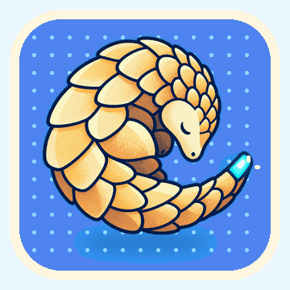

# Corta brand assets

The name "Corta", the pangolin mascot and the application icon are **not**
covered by the Apache licence over the source code. See `NOTICE` at the
repository root.

## Files

| File                        | What it is                                                      |
| --------------------------- | --------------------------------------------------------------- |
| `../../AppIcon.icon`        | Production macOS Icon Composer bundle                            |
| `corta-pangolin-mascot.png` | Transparent mascot master, 1254 × 1254                           |
| `corta-pangolin-loop.gif`   | Looping mascot animation, 360 × 360                              |
| `session-ended.png` | Ended session: the centered glass status panel over dimmed, retained output, from an isolated local-zsh UI fixture |
| `native-tab-icon.png` | The tab strip in the titlebar row, with single-pane and split-pane program icons, from an isolated development build |
| `screenshot.png` | README hero screenshot — original 2484 × 1524 PNG, light theme |
| `interaction-demo@2x.gif` | Optional interaction loop, 1920 × 1176, 10 seconds; not embedded in READMEs |
| `interaction-demo.mp4` | Website interaction loop, 1600 × 980, 60 fps, 12 seconds, no audio |
| `interaction-demo-poster.png` | Website video poster, 1600 × 980 |
| `input-source-indicator.png` | Independent Chinese input-source badge, separated from toolbar action buttons, from an isolated demo shell |
| `input-source-long-command.png` | Right-edge badge moved below a long command, without changing the grid |
| `history-suggestions.png` | Local zsh history suffix, from the isolated history-suggestions UI fixture |
| `directory-suggestions.png` | Local zsh candidate glass capsule and command-status marks from an isolated UI-test demo shell |
| `about.png`                 | About with separated links (development build)                   |
| `social-preview.png`        | GitHub social preview card, 1280 × 640                            |

The scripts that make these images live in `scripts/brand/`:
`compose-screenshot.swift` adds the shadow, margin and poster type to a
window capture, and `social-preview.swift` renders the social preview card.

## The mascot animation

<p align="center">
  
</p>

The animated counterpart of `corta-pangolin-mascot.png`, for pages that can
show motion; the project README keeps the still. The loop is intentionally subtle: the curled pangolin breathes and floats by a
few pixels while the cyan cursor at the tip of its tail pulses. It is 360 x 360
pixels and designed to remain legible when displayed at 180–240 pixels wide.

## The social preview card

Rendered by a script rather than checked in from a design tool, so the wording
can change without reopening an editor. Pure AppKit and Core Text — nothing to
install. Run it from the repository root; the mascot is loaded by a relative
path.

```sh
swift scripts/brand/social-preview.swift docs/brand/social-preview.png light
swift scripts/brand/social-preview.swift /tmp/dark.png dark
```

The card is uploaded by hand: repository **Settings** ▸ **General** ▸
**Social preview**.

## Taking the screenshot

Never point the app at the machine's real shell or configuration for this —
a prompt carries a username and a hostname, and `launchctl setenv SHELL`
would change the shell for every application the user launches afterwards
(`CLAUDE.md`). Everything goes in the environment of the one launch you
control. The images here, and the social posters made from the same
captures, were taken like this, with nothing outside one scratch directory
touched:

- **The development build** (`CortaDev`, D22), so the installed Corta and
  its configuration are never involved.
- **`CORTA_STAGE_DIR`** pointing at a scratch directory whose `config`
  sets `appearance = light`, `font-size = 14`, the window's `columns` and
  `rows`, and turns off `restore-windows` and `suggest-applications-folder`.
- **`ZDOTDIR`** pointing at a scratch `.zshrc` that sets a neutral prompt
  (`%1~ ❯`, green or red by exit status), sources the shell integration
  script, and feeds queued commands to the prompt from a `zle-line-init`
  widget, so every command on screen ran for real.
- **Public content only** — a local clone of this repository for `git log`,
  the mascot for `kitten icat`, a demo table for wide characters.
- **`screencapture -o -l <window id>`** for the window without its shadow,
  found by the process id; the shadow and the margin are added afterwards,
  so every image matches. A popover and an attached sheet are child
  windows and come with their window; the command palette is a window of
  its own, laid on with `compose-screenshot.swift overlay`.
- **The SFTP browser** connects through `CORTA_SFTP_SSH` to a stand-in
  `ssh` that runs `/usr/libexec/sftp-server -d <scratch tree>`, so the
  listing and the upload are real and no server is involved. Move the
  window to the right edge of the screen before opening the transfers
  popover: macOS keeps a popover on screen, not inside its window, and
  one that hangs past the window shows the desktop through its glass.
- **A short stage path.** Settings prints the config file's path in its
  footer; a symbolic link such as `/tmp/corta-demo` to the scratch stage
  keeps the scratch directory's name out of the picture. Remove it after.
- **A mascot sized for the pane.** `kitten icat` scales a larger picture
  to the pane's width; resizing it first keeps it the size the layout
  wants.
- **Keys by code.** Synthetic typing goes through the active input
  method — Pinyin turns `[` into `【` — so shortcuts are sent as key codes
  (`key code 33 using command down`), and text goes in by pasting.

```sh
swiftc -O scripts/brand/compose-screenshot.swift -o /tmp/compose
/tmp/compose plain window.png docs/brand/screenshot.png
/tmp/compose overlay window.png palette.png 350 184 with-palette.png
/tmp/compose poster with-palette.png card.png "Every command, one search away" "⇧⌘P opens the command palette"
```

## README screenshot and website demo

All nine READMEs use the original lossless `screenshot.png`, showing the light-theme tab strip and three split panes with multilingual text, the mascot and colour samples. Each screenshot links directly to that locale's homepage `#demo` section. Only the display width is specified, so GitHub can scale the image proportionally within its article column.

The homepage retains its dedicated 12-second silent MP4, edited from an isolated light-theme development-build recording. It shows pane splits, moving running sessions, tab interactions and detached windows. Pauses are shortened and the end returns to the beginning with a crossfade. It reflects the main development tree, including changes listed in Unreleased.

`render-interaction-demo.swift` composes the video, poster and optional raw GIF frames from an app-only recording and a clean window-button capture. `website/scripts/encode-interaction-gif.mjs` encodes those frames using Sharp. The existing GIF is retained as an optional asset; it is not used as a README hero. A different recording requires adjusting the renderer's source rectangles and edit timeline.

The homepage initially renders a responsive poster and loads the muted video when visible. It includes a pause/play button and respects reduced motion by default.
